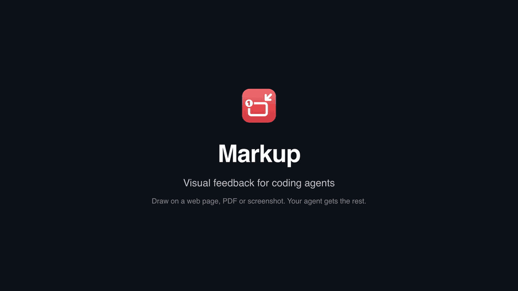

# Markup

**Markup makes it easy to give visual feedback to coding agents.** Mark up websites and
PDFs, and it generates the prompt and takes the screenshots for you.

[](docs/demo.mp4)

Telling an agent "the button, no, the other one, make it bigger" in words is slow and
easy to get wrong. With Markup you point at the thing instead: click an element or draw
on the page, type a note, and export. Your agent gets a Markdown file with every note,
the element it refers to (selector and `file:line`), and screenshots it can read, plus a
ready-made prompt on your clipboard.

It runs entirely on your machine, with no account and no install step: it needs only
Node.js (18+) and Google Chrome (Chromium, Edge and Brave also work). It was built and
tested on macOS; Linux and Windows are supported in the code but have had little
testing, so reports are welcome.

## Get it

```sh
git clone https://github.com/harrymunro/html-markup.git
cd html-markup
./markup test/fixtures/site/index.html   # try it on the sample page
```

## Run it

```sh
./markup                      # open the window, then drop a file in or click Open
./markup path/to/index.html   # open a file straight away (HTML, PDF, PNG/JPG/…)
```

To run it from anywhere, link it onto your PATH once:

```sh
ln -s "$PWD/markup" /usr/local/bin/markup
```

Close the window (or press Ctrl+C in the terminal) to quit. Running `markup file` while a
window is already open hands the file to that window.

### Keep it in the Dock

```sh
scripts/build-app.sh
```

builds `Markup.app` in this folder. Drag it onto the Dock: one click opens Markup, and
clicking again brings the open window to the front. The app only starts this checkout, so
rebuild it if you move the folder. (The open window itself is a Chrome window, so it
appears under a Chrome icon while it is running.)

## Marking up

| Tool | Key | What it does |
| --- | --- | --- |
| Interact | I | Use the page normally: click, type, open menus and dialogs |
| Move | V | Select, drag and resize marks; double-click one to edit its note |
| Comment | C | Click an element to attach a note to exactly that element |
| Box / Circle | R / O | Drag around something (hold Shift for a square or circle) |
| Arrow | A | Drag towards the thing you mean (Shift snaps to 45°) |
| Draw | P | Freehand |
| Text | T | Click anywhere and type |

Every mark gets a number and a note. A comment or text mark needs its note (leave it
empty and the mark is dropped); on shapes the note is optional, and Markup asks before
exporting any that have none. Marks are attached to the element they
refer to, so they stay put while you scroll, resize the window, switch to a phone or
tablet width, or reload the page after your agent has changed it.

Other things worth knowing:

- **⌘Z / ⇧⌘Z** undo and redo, **Delete** removes the selected mark, **⌘E** exports.
- The width menu previews the page at desktop, tablet and phone sizes.
- Marks made on something temporary (an open dialog, a second page) keep a close-up from
  the moment you made them, so they still export after you close the dialog or navigate.
- "Notes on page" toggles whether notes are shown beside the marks or only numbers.
- "Overall feedback" in the sidebar is for anything that isn't about one spot.

## What your agent gets

**Export feedback** writes a folder and copies a ready-made prompt to the clipboard:

```
markup-feedback/index-20261114-195346/
  feedback.md         a checklist of the points, then every annotation: your note,
                      the element, selector, file:line
  overview-1.png      the page with all visible marks in place (one per distinct view)
  annotation-01.png   close-up of each mark (identical close-ups are saved once)
  …
```

`feedback.md` opens with a checklist, one line per note, and both it and the prompt ask
the agent to report back on every point by number, so a skipped one shows. Marks on the
same element are cross-referenced, since they are often one thought written in two
goes, and marks without a note are listed apart at the end.

An entry in `feedback.md` looks like this:

```md
### 1. Comment (red)

> Make this button bigger and use the brand blue

- **Element:** `<a class="btn" id="cta" href="#pricing">` — “Get started” — `index.html:22`
  - selector: `#cta`
- **Screenshot:** `annotation-01.png` (in context: `overview-1.png`)
```

By default the folder is created next to the file you reviewed (with its own `.gitignore`,
so it never ends up in a commit). The export dialog can switch to
`~/Downloads/markup-feedback` instead, reveal the folder in Finder, or download it as a zip.

### Let the agent open it for you

```sh
markup --wait path/to/index.html
```

This opens the file, waits while you mark it up, and when you click **Send feedback**
prints the path of `feedback.md` and exits. An agent can run that command itself and carry
on with your feedback as soon as you send it. For Claude Code, a line like this in
`CLAUDE.md` is enough:

```md
When I ask to review a page visually, run `markup --wait <file>` (allow up to 10 minutes),
then read the feedback file it prints and the screenshots beside it, and apply the feedback.
```

## How it works, and its limits

- A small local server (bound to 127.0.0.1 on a random port) serves the page from its own
  folder, so relative and root-absolute assets load as they would on a real site. The UI
  opens in a dedicated Chrome window with its own profile, separate from your normal
  browser.
- Screenshots are taken by Chrome itself over its DevTools connection, so they are exactly
  what you saw.
- `file:line` references come from tagging each element with its source line as the HTML
  is served. Elements created by JavaScript are reported as "inside the element at …".
- The reviewed page's scripts run with access to this local server, which only ever serves
  files from that page's folder (never dotfiles). Review pages you trust, as you would when
  opening them in any browser.
- It opens files, not URLs. For an app that only runs on a dev server, open a built HTML
  file, or take a screenshot and mark that up.
- PDFs are rendered with the bundled pdf.js; marks report the page number and the text
  under them.

## Tests

```sh
npm test    # drives the real UI in headless Chrome: HTML, PDF, image and responsive flows
```

## Contributing

Issues and pull requests are welcome. Two things to know before you start: the project
has no npm dependencies and no build step, and that is deliberate; and any change to
`server.js` or `app/` should come with a passing `npm test`.

The demo above is recorded from the real app by `node scripts/record-demo.js` (needs
ffmpeg), so it can be re-made whenever the UI changes.

## Licence

[MIT](LICENSE). The bundled copy of [pdf.js](https://mozilla.github.io/pdf.js/) in
`vendor/pdfjs/` is under the Apache 2.0 licence, and the fonts and character maps beside
it carry their own licences in the same folder.
